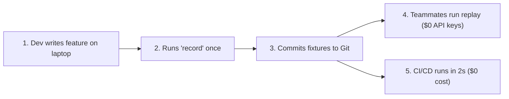

<pre align="center">
  _____                     ____            _             
 |_   _| __ __ _  ___ ___  |  _ \ ___ _ __ | | __ _ _   _ 
   | || '__/ _` |/ __/ _ \ | |_) / _ \ '_ \| |/ _` | | | |
   | || | | (_| | (_|  __/ |  _ <  __/ |_) | | (_| | |_| |
   |_||_|  \__,_|\___\___| |_| \_\___| .__/|_|\__,_|\__, |
                                     |_|            |___/ 
</pre>

<p align="center">
  <strong>Record once. Replay reliably. Deterministic testing, AI chaos engineering, and cost guardrails for LLM applications and autonomous AI agents.</strong>
</p>

<p align="center">
  <a href="https://pypi.org/project/tracereplay/"></a>
  <a href="https://github.com/rakshithkumar608/TraceReplay/actions/workflows/ci.yml"></a>
  
  <a href="https://github.com/astral-sh/ruff"></a>
  <a href="https://mypy-lang.org/"></a>
  <a href="LICENSE"></a>
</p>

---

## What is TraceReplay?

**TraceReplay** is an open-source deterministic testing, fault injection, and cost guardrail platform purpose-built for applications powered by Large Language Models (LLMs) and autonomous AI agents.

In traditional software, network mocking tools like VCR record simple HTTP calls. But **modern AI agents are non-deterministic, multi-turn state machines**:
- They execute dynamic Python tools, suffer from stealth token bloat, drift subtly across prompt engineering tweaks, and crash on third-party API rate limits.
- Repeated live API calls burn hundreds of dollars in CI, introduce 5-second network latencies per request, and cause flaky test failures.

TraceReplay captures multi-turn LLM reasoning, tool executions, and latency metrics into inspectable local fixtures—enabling **sub-millisecond deterministic replays**, **zero live API costs in CI**, **chaos resilience validation**, and **intelligent prompt drift tolerance**.

---

## Quick Installation

Install TraceReplay using any modern Python package manager:

```bash
# Core package (lightweight, zero external AI dependencies)
pip install tracereplay

# With OpenAI SDK support
pip install "tracereplay[openai]"

# With all AI provider adapters (OpenAI, Claude, Gemini, Groq, Mistral, DeepSeek)
pip install "tracereplay[all]"

# Using uv (ultra-fast)
uv add tracereplay

# Using Poetry
poetry add tracereplay
```

---

## Interactive CLI & Doctor

TraceReplay includes a command-line interface to inspect your environment, verify installed AI SDKs, and measure recorded cost savings:

```bash
# 1. Print welcome banner & quickstart
tracereplay

# 2. Check installed AI provider SDKs and environment API keys
tracereplay check

# 3. View recorded fixture metrics, token counts, and USD cost savings
tracereplay stats
```

#### Example `tracereplay stats` output:
```text
Recorded Fixture Metrics (.tracereplay/fixtures):
-------------------------------------------------------
  Total Fixture Files:      12
  Total Interactions:       48
  Total Tokens Recorded:    142,850
  Estimated Cost Saved:     $1.4285 USD
-------------------------------------------------------
Every replay execution saves $1.4285 USD in API costs!
```

---

## How Developers Use TraceReplay

TraceReplay supports **two flexible developer workflows**:

### Pattern A: Directly in Main Code (`main.py`)
*Ideal for rapid local development and prototyping without touching pytest.*

A developer writes normal code, wraps their client with `patch(client)`, and runs inside `session(...)`:

```python
import os
from openai import OpenAI
from tracereplay import patch, session

# 1. Normal client, wrapped with TraceReplay
client = patch(OpenAI())


def ask_assistant(prompt: str) -> str:
    # This function is 100% normal OpenAI code!
    response = client.chat.completions.create(
        model="gpt-4o",
        messages=[{"role": "user", "content": prompt}],
    )
    return response.choices[0].message.content


# 2. Run inside session (mode='auto' records on 1st run, replays on 2nd run!)
mode = os.getenv("TRACEREPLAY_MODE", "auto")

with session("assistant_run", mode=mode):
    answer = ask_assistant("Explain quantum computing in 1 sentence.")
    print(answer)
```

- **Run 1 (Record):** Calls OpenAI once over the network (~2.5s) and saves the response.
- **Run 2+ (Replay):** Finishes in **0.004 seconds** for **$0.00** without touching the network!

> [!NOTE]
> **Production Safety Guarantee:** In production (where no `session()` is active, or when `TRACEREPLAY_DISABLE=1` is set), TraceReplay becomes completely inert. It executes real calls directly at native speed with zero overhead and zero disk writes.

---

### Pattern B: In Test Suites (`pytest`)
*Ideal for clean production codebases where production code remains 100% pure.*

Your application code stays completely untouched. You only add `@pytest.mark.trace_replay` in your test file:

```python
# test_app.py
import pytest
from my_app import client, ask_assistant


@pytest.mark.trace_replay
def test_assistant(auto_patch):
    auto_patch(client)  # TraceReplay intercepts this client transparently

    reply = ask_assistant("What is 2 + 2?")
    assert "4" in reply
```

Run tests from the terminal:
```bash
# 1. First run: records live interactions into .tracereplay/fixtures/
pytest -v --tracereplay-mode=record

# 2. Subsequent runs: replays offline in 0ms without API keys
pytest -v --tracereplay-mode=replay
```

---

## How Development Teams Collaborate



1. **Local Recording:** Developer A builds an AI agent and runs `pytest --tracereplay-mode=record`.
2. **Git Commit:** Developer A commits `.tracereplay/fixtures/*.json` into Git alongside their code.
3. **Teammates Pull:** Developer B pulls the repo and runs tests. **Developer B doesn't even need an OpenAI API key**—TraceReplay replays the exact fixtures in milliseconds.
4. **Fast CI/CD:** GitHub Actions runs `pytest --tracereplay-mode=replay`. 100 tests finish in 3 seconds for **$0.00**, eliminating the security risk of storing private API keys in CI secrets.
5. **Prompt Updates:** When updating prompts or models months later, run `--tracereplay-mode=record` once to refresh the fixtures.

---

## The 5 Breakthrough WOW Features

TraceReplay introduces 5 breakthrough capabilities purpose-built for LLMs and autonomous AI agents:

---

### 1. 🕒 Time-Travel Forking (`fork_at_step`, `fork_at_tool`)
**The Problem:** An autonomous agent executes 10 sequential reasoning steps (search $\rightarrow$ calculate $\rightarrow$ filter $\rightarrow$ write code). Step 8 encounters a bug. In traditional testing, you had to re-run steps 1 through 7 every single time—wasting minutes and burning API tokens on repeated reasoning.

**How It Works:** TraceReplay fast-forwards through steps 0..N deterministically from disk for **$0.00**, and branches into live recording starting at any target step or tool:

```python
import tracereplay as tr

# Replay steps 0..7 instantly from "base_workflow", then fork into live execution at step 8:
with tr.session(
    name="base_workflow",
    fork_at_step=8,
    fork_session_name="onboarding_bugfix_branch",
    fork_to_mode="record",
):
    # Steps 0..7 replay deterministically from disk in 0.001 seconds
    # Step 8 executes live against the provider and records to the new branch fixture!
    run_10_step_agent()
```

You can also fork right when a specific tool is called:
```python
with tr.session(name="base_workflow", fork_at_tool="execute_sql_query", fork_to_mode="record"):
    run_agent()
```

---

### 2. 💥 AI Chaos Engineering & Fault Injection (`tr.chaos`)
**The Problem:** How do you test whether your agent's retry logic, exponential backoff, or fallback model works when OpenAI returns a `429 Too Many Requests` or `504 Gateway Timeout`? You cannot force third-party APIs to crash on demand!

**How It Works:** TraceReplay injects authentic, realistic provider errors right into your client or tool executions on demand without touching the internet:

```python
import tracereplay as tr

# Inject a native 429 Rate Limit error on turn 2:
chaos_fault = tr.chaos.rate_limit(step=1, retry_after=5, native=True)

with tr.session("resilience_test", chaos=[chaos_fault]):
    # Your agent's backoff and retry handling is tested under real conditions!
    run_agent_with_retry()
```

TraceReplay supports **9 native fault types**:
- `tr.chaos.rate_limit(step=..., retry_after=5)`: Simulates 429 Rate Limits.
- `tr.chaos.timeout(step=..., duration_seconds=2.0)`: Simulates network & API timeouts.
- `tr.chaos.server_error(step=..., status_code=503)`: Simulates 5xx provider outages.
- `tr.chaos.context_length_exceeded(max_context=128000)`: Simulates token window overflows.
- `tr.chaos.malformed_json()`: Corrupts structured JSON outputs.
- `tr.chaos.hallucinated_tool(tool_name="unauthorized_db")`: Injects invalid tool calls.
- `tr.chaos.safety_refusal()`: Simulates safety and content filter refusals.
- `tr.chaos.latency_jitter(min_delay_ms=500, max_delay_ms=2000)`: Simulates network lag.
- `tr.chaos.custom_exception(exception=MyError("Custom failure"))`: Injects domain errors.

---

### 3. 💰 Token, Cost & Latency Guardrails (`tr.guardrails`)
**The Problem:** A developer accidentally writes a `while True` loop calling LLMs, costing hundreds of dollars in CI, or a prompt engineering change silently inflates token usage by 300%.

**How It Works:** TraceReplay enforces strict budget caps. If an agent exceeds your dollar threshold, token count, or latency limit, TraceReplay acts as a circuit breaker and cuts off execution:

```python
import tracereplay as tr

# Hard budget caps: Max $0.05 USD and max 2,000 total tokens
budget = tr.guardrails.cost_budget(max_cost_usd=0.05)

with tr.session("financial_analyst", guardrails=budget) as sess:
    # If a rogue multi-turn loop exceeds $0.05, TraceReplay cuts off execution
    # immediately by raising CostBudgetExceededError!
    run_agent()

# Print comprehensive token and dollar breakdown:
print(sess.guardrail_report.summary_text())
```

> [!TIP]
> **Zero-Cost Offline Regression Testing:**
> When replaying fixtures in CI, TraceReplay calculates replayed tokens and costs against your limits. If a prompt grew too large, CI catches it offline at **$0 cost**!

---

### 4. 🧠 Semantic Diff & Smart Drift Detection (`tr.semantic`)
**The Problem:** Normal mocking is brittle: if you recorded `"The capital of France is Paris."`, but tomorrow your prompt outputs `"Paris is France's capital."`, normal tools scream **FAIL: Strings do not match!** even though the meaning is 100% identical.

**How It Works:** TraceReplay calculates pure-Python hybrid semantic similarity (word-token cosine + Levenshtein sequence ratio). If the meaning is $\ge 85\%$ identical, it accepts it and prints an inline colorized word diff:

```python
import tracereplay as tr

with tr.session(
    name="customer_service",
    mode="replay",
    semantic_matching=True,
    semantic_threshold=0.85,  # Tolerates drift if similarity >= 85%
) as sess:
    # "You are a customer service assistant. Explain refund policy."
    # vs
    # "You are a polite customer support assistant. Explain refund policy concisely."
    # Replays successfully without crashing!
    run_agent()

# Inspect prompt evolution across your test suite:
print(sess.drift_report.summary_text())
```

TraceReplay prints an inline colorized word diff directly in your terminal:
```text
Inline Word Diff:
  you are a {+polite+} customer [-service-] {+support+} assistant . explain refund policy {+concisely+} .
  Added words:   ['polite', 'support', 'concisely']
  Removed words: ['service']

[Hint] Prompts are 83.9% similar. Enable semantic matching (`semantic_threshold=0.80`) to allow this prompt drift.
```

---

### 5. ⏳ Deterministic Clock & Freeze Time (`tr.clock`)
**The Problem:** An agent has exponential backoff (`time.sleep(2)`, `time.sleep(4)`, `time.sleep(8)`). Running tests takes **14 real seconds** just waiting for sleep timers! Plus, tests checking dynamic dates ("Today is 2026-11-07") fail next week when the calendar changes.

**How It Works:** TraceReplay freezes system time to a fixed timestamp, and **simulates `time.sleep` at lightspeed**:

```python
import time
from tracereplay import freeze_time

# Freeze datetime to a fixed timestamp and fast-forward all sleep() calls instantly:
with freeze_time("2026-11-07 10:00:00 UTC", simulate_sleep=True):
    # A 60-second exponential retry sleep completes in 0.002 seconds!
    time.sleep(60.0)
```

> [!NOTE]
> **Automatic Fixture Time Sync:** In `REPLAY` mode, TraceReplay automatically freezes `datetime.now()` to the exact second the fixture was recorded, so time-sensitive prompts never break!

---

## Supported Providers

TraceReplay provides universal adapters that normalize requests and responses across all major AI providers:

| Provider | SDK / Client | Streaming | Function / Tool Calling |
| :--- | :--- | :---: | :---: |
| **OpenAI** | `openai.OpenAI` (Sync & Async) | ✅ Supported | ✅ Supported |
| **Anthropic Claude** | `anthropic.Anthropic` (`messages.create`) | ✅ Supported | ✅ Supported |
| **Google Gemini** | `google.genai` / `google.generativeai` | ✅ Supported | ✅ Supported |
| **Groq** | `groq.Groq` (Ultra-low latency LPU) | ✅ Supported | ✅ Supported |
| **Mistral AI** | `mistralai.Mistral` | ✅ Supported | ✅ Supported |
| **DeepSeek** | OpenAI-compatible endpoint | ✅ Supported | ✅ Supported |
| **Ollama / Local LLMs** | Local inference (`http://localhost:11434`) | ✅ Supported | ✅ Supported |

---

## Security & Automatic PII Redaction

TraceReplay automatically sanitizes sensitive data before writing to disk:
- **Credential Masking:** API keys (`sk-...`, `gsk_...`), authorization headers (`Bearer ...`), and organization tokens are masked as `[REDACTED]`.
- **Custom PII Redaction:** Pass regex patterns or dictionary keys to sanitize credit cards, emails, or personal identifiers.
- **Path Traversal Protection:** Fixture names are strictly resolved and validated within target storage roots.
- **Local-First Architecture:** Recordings remain 100% on your machine or repository. Zero data is sent to external servers.

---

## Contributing

We welcome contributions! Please see [CONTRIBUTING.md](CONTRIBUTING.md) for details on setting up your local development environment, running tests, and submitting pull requests.

```bash
# Clone the repository
git clone https://github.com/rakshithkumar608/TraceReplay.git
cd TraceReplay

# Install in editable mode with development dependencies
pip install -e ".[dev,all]"

# Run full test suite (168 unit & integration tests)
pytest -v

# Run linting and type checking
ruff check .
mypy src tests examples
```

---

## License

This project is licensed under the [MIT License](LICENSE).
